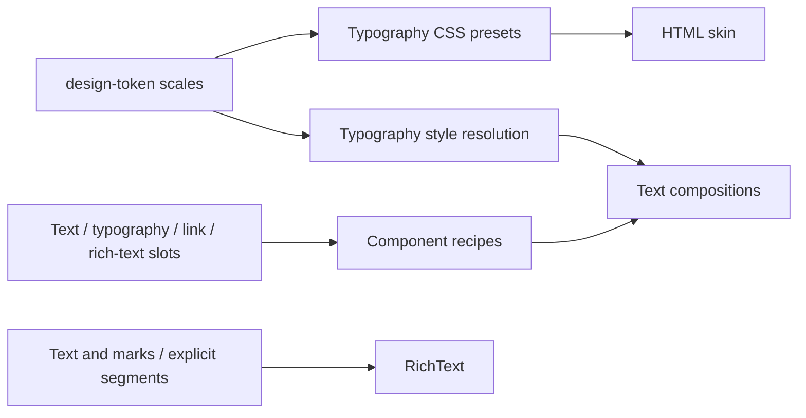

# Typography

Typography owns text compositions, text slots, token-to-style resolution and range
formatting. The `html` domain owns native elements and its explicitly enabled skin.
Shared font scales belong to `design-token`; `theme` emits their CSS variables.
This domain is a separate embedded repository within design-system.

## HTML consolidation

All eleven original component families were compared with their HTML equivalents.
The decision is based on additional API and behaviour, rather than matching tags.

| Original family | Decision | Reason / replacement                                                                                           |
| --------------- | -------- | -------------------------------------------------------------------------------------------------------------- |
| Abbr            | Removed  | Only native attributes, children, a class and CSS. Use HtmlAbbr / RecipeHtmlAbbr and opt into HTML skin.       |
| InlineCode      | Removed  | Only native attributes, children, a class and CSS. Use HtmlCode / RecipeHtmlCode and HTML skin.                |
| Kbd             | Removed  | Only native attributes, children, a class and CSS. Use HtmlKbd / RecipeHtmlKbd and HTML skin.                  |
| Heading         | Keep     | Numeric semantic level independent of visual size, text/children priority and typography tokens.               |
| Text            | Keep     | Text/children API, token resolution, block/disabled appearance and accessible label mapping.                   |
| Paragraph       | Keep     | Text contract on a paragraph with its own reading rhythm. Shares RecipeText, but is not a native-only wrapper. |
| Blockquote      | Keep     | Source label, optional attribution footer, citation URL, border and surface controls.                          |
| Link            | Keep     | Disabled activation, text fallback, tone, size and underline API.                                              |
| Badge           | Keep     | Label/children, variants, size and disabled appearance; a passive label unless composed into an action.        |
| BadgeGroup      | Keep     | Collection, visibility limit, overflow and optional item actions. Actions use native buttons.                  |
| RichText        | Keep     | Range marks, explicit segments, links and an HTML branch; not equivalent to one native element.                |

A source scan of available workspace application `src` directories and physical
module sources found no non-generated consumers of the three removed families
outside their own implementations/stories. HTML Node's local Abbr/Kbd names refer
to its own HTML wrappers and remain unchanged. Generated root/domain exports and
the sandbox manifest need human regeneration before integration acceptance.
Unseen consumers of a published package cannot be established by this scan.

This is a public API removal. External consumers must replace the old component
and recipe imports, remove dependencies on `c-typography-abbr`,
`c-typography-inline-code` and `c-typography-kbd`, and explicitly enable the skin:

```svelte
<script lang="ts">
	import HtmlAbbr from '$stylist/html/component/atom/abbr/index.svelte';
	import HtmlCode from '$stylist/html/component/atom/code/index.svelte';
	import HtmlKbd from '$stylist/html/component/atom/kbd/index.svelte';
	import HtmlStyle from '$stylist/html/component/atom/style/index.svelte';
	import { serializeHtmlStylesheet } from '$stylist/html/function/serialize/html-stylesheet';
	const stylesheet = serializeHtmlStylesheet();
</script>

<svelte:head><HtmlStyle text={stylesheet} /></svelte:head>
<div data-html-skin>
	<HtmlAbbr title="HyperText Markup Language">HTML</HtmlAbbr>
	<HtmlCode>const answer = 42;</HtmlCode>
	<HtmlKbd>Enter</HtmlKbd>
</div>
```

The `$stylist` imports above are workspace aliases; package consumers use the
corresponding `stylist-svelte/html/...` subpaths. Native wrappers stay unstyled
without the scope attribute. Skin deliberately supplies the shared baseline,
not pixel-identical copies of the removed components' padding, fonts or borders.
Consumer classes can override it; the stylesheet uses `@layer html` and `:where`.

## Remaining entities and data flow

- `const/preset/typography`: body, heading, caption and code CSS presets, used by
  HTML skin. Kept here; removing three wrappers does not remove preset ownership.
- `interface/slot/{text,typography,link,rich-text}`: reusable data contracts.
  Text/typography slots have consumers across public and private domains.
- `interface/recipe/*`: eight remaining recipes; Paragraph reuses RecipeText.
- `function/script/inline-style`: resolves token props for Heading, Text,
  Paragraph and RichText. It is not replaced by skin, which has no props API.
- `function/script/rich-text-segments`: splits overlapping marks into segments.
- `function/script/text-normalize`: used by sandbox error serialization.
- `function/script/to-nullable-string`: public utility kept for compatibility;
  no internal direct-path consumer was found. It has no HTML equivalent.
- `component`: eight remaining compositions and their typed stories.
- `test/render`: Heading story controls and native/typography contract regressions.



## Behaviour clarified by the review

Text and Paragraph apply their computed accessible label. Blockquote filters
composition props and keeps citeUrl separate from its attribution label. Disabled
Link removes href, rejects click activation and cannot be forced back into the
tab order by a consumer tabindex. BadgeGroup only creates buttons for items with
actions and uses native disabled/keyboard semantics. RichText honours explicit
segments before generated text marks, applies ariaLabel, and always uses a block
container for HTML flow content, even when block=false. Disabled segment links
have no href. The HTML string branch continues to accept caller-provided HTML;
this consolidation does not change its trust boundary.

## Validation and integration

Targeted render tests cover all retained compositions and the three existing HTML
replacements. Skin parsing/token tests are in the HTML domain. Actual computed
styles, theme changes, isolation, local overrides and keyboard interaction must
also be checked in a real browser; jsdom alone is not CSS evidence.

Human-only integration commands from `D:/2026/cloudflare/lankatour.ru`:
`yarn stylist:index`, `yarn stylist:manifest`, then `yarn stylist:errors`.
Parent barrels are intentionally not hand-edited. Until regeneration, their old
references to the removed families are stale. No package build or release is
part of this change.
